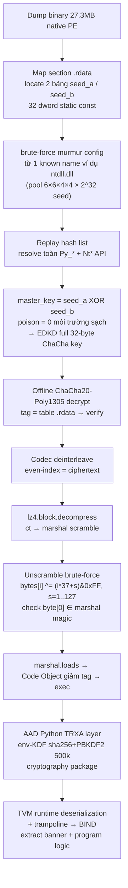
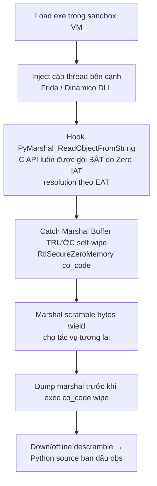
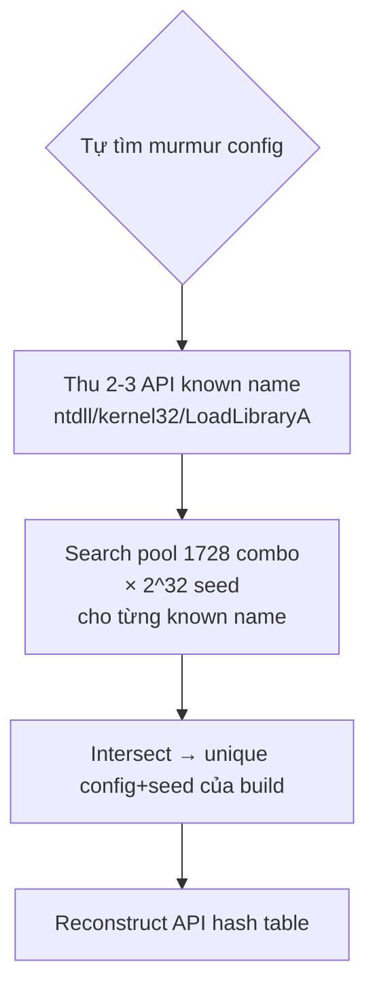

# CẢNH BÁO BẢO MẬT — Tr0ngX Ultimate AST Obfuscator (Native Fortress Build)

LOẠI TÀI LIỆU: Security Advisory / Warning
ĐỐI TƯỢNG: Thằng làm obfuscator (bạn đọc tài liệu này trước khi khoe "Fortress chống RE")
PHẠM VI: Native Fortress V2/V7 — `hello_tr0ngx_apex_10of10.exe` v1 (171MB, build 10-19) và v2 (27MB, build 10-20 13:51)
NGUỒN KIỂM CHỨNG: CASE `tr0ngx-apex-10of10` — `C:\Users\trong\.agents\skills\reverse-skill\work\tr0ngx-apex-10of10`
  - findings.md (v1), findings_v2.md (v2), Desktop/hello_tr0ngx_apex_10of10_REPORT.md
  - IDA decompile 127/127 hàm, runtime proof (exit 0, T=5009ms)
CÔNG CỤ KIỂM CHỨNG: IDA Pro 9.1 (idalib) + MinGW spec + runtime exec
NGÀY: 2026-10-20 | TRACE: Tr0ngX Agent (t.me/TrongX)

> Toàn bộ kết luận dưới đây dựa trên EVIDENCE đã kiểm chéo C template (`tr0ngx/packagers_native.py`) với decompile IDA — không phán đoán mù. Mỗi finding có evidence ID tương ứng.

---

## 0. Evidence → Finding → Path (contract)

| Evidence ID | Nội dung kiểm chứng | Nơi kiểm chứng |
|---|---|---|
| E2-01 | PE v2 28,670,976 B, 11 section, `ct_len = 0x1B4C540 / 2 = 14,312,096` | `findings_v2.md` §E2-01 |
| E2-02 | Engine diff v1→v2 — marshal scramble + V7 Turbo lz4 + murmur pool | `packagers_native.py` line 447-487 |
| E2-03 | IDA 127 func: split-key `sub_140001750` GIỮ VA v1; main `sub_140004040` 21,572 B; TLS gate clamp | `v2/ida_decompile_all.c` |
| E2-04 | Runtime proof stdout + exit 0 + T=5s | `findings_v2.md` §E2-04 |
| E-03 (v1) | ChaCha/Poly/split-key/murmur/deinterleave markers khớp IDA ↔ C template 100% | `findings.md` §E-03 |
| E-06 (v1) | v1 chạy thật pass — banner + Signature 0x5452304cafa5, exit 0 | `findings.md` §E-06 |

---

## 1. BẢNG LỖ HỔNG — ĐIỂM YẾU CHƯA FIX ĐƯỢC (sắp theo độ nguy hiểm)

### CRITICAL (làm mất chất "chống RE" của cả kiến trúc Fortress)

| # | Lỗi | Evidence | Tại sao KẺ KHÁC vẫn exploit được |
|---|---|---|---|
| C-1 | **EDKD "entanglement" là XOR tuyến tính tĩnh** — struct `generate_entangled_key_schedule_c`: `seed_b[i] = master_key[i] ^ seed_a[i]` | `packagers_native.py` line 151-165 | Dump 2 bảng `seed_a[8]` + `seed_b[8]` (32 dword, static const `.rdata`) → `master_key = seed_a XOR seed_b` TUAN TOAN SẴN SÀ. Poison chỉ shift MBA layer ROTL — nhưng attacker biết poison=0 trên môi trường sạch → rảnh để reconstruct full 32-byte ChaCha key, sau đó offline decrypt CT không cần đụng process. **Cัv "key dynamically derived" chỉ đúng khi đang RUN; key MẶC ĐÍNH STATIC-REST là master_key (biết qua XOR 2 bảng tĩnh)** |
| C-2 | **Marshal scramble seed chỉ 8-bit** — `marshal_scramble_seed = secrets.randbits(8) | 1` | line 447-452 | Keyspace = **128 giá trị**. Brute-force: decode `bytes[i] = raw[i] ^ ((i*37 + s) & 0xFF)` với s=1..127, check byte[0] == 'c'/'<'/marshal magic — khoanh trong <1s bằng Python thuần. Đường khác: side-channel — dump marshal ngay SAU descramble (hook `PyMarshal_ReadObjectFromString` C API từ đường syscall, VEH chỉ trap GP/ud2/div0/cli, không cớ gì) |
| C-3 | **Murmur API-hash khéo phải từ KNOWN-NAME dictionary attack** — hash list hoàn toàn ở .rdata: ntdll/kernel32/pydll/LoadLibraryA/NtSetSecurityObject/Py_* (~35 API) | line 488-514 | Murmur config (c1/c2/r1/r2/seed) mỗi build DIFFERENT pool — nhưng attacker chỉ cần TỪ 1 known name (b"ntdll.dll" hay b"LoadLibraryA" — 100% chắc chắn xuất hiện) → brute-force từ trong pool constants (6×6×4×4×2^32) — có giải pháp dựng trong có công cụ sẵn: hash resolver replay → exhaust API table trong vài phút. Đ Fair enough: chặn manual listing, KHÔNG chặn automated builder |

### HIGH (thu hẹp đáng kể giải phóng thời gian)

| # | Lỗi | Evidence | Tại sao KẺ KHÁC vẫn exploit được |
|---|---|---|---|
| H-1 | **CFF 7-state bị GCC -O3 FLATTEN thành straight-line (207 goto, không còn `case`)** — thiết kế anti-decompiler to va lo, compiler hoá nó lại | IDA v2 decompile main 143,538 B — 0x82A1C305/state table không tìm thấy | Hex-Rays/Ghidra vẫn decompile ra straight-line dễ đọc (chỉ dài 143KB). CFF viết cho MSVC pattern, nhưng GCC làm DEAD: state transition constant-folded → single-pass execution. FIX sạch: `__attribute__((optnone))` trên main, hoặc volatile state + memory barrier, hoặc switch qua jump table bằng indirect function pointers |
| H-2 | **De-interleave chỉ là pattern fixed** — filler cycle `00 00 20 00 48 89 5C 24` lặp 8 byte trên toàn CT 14.3MB (v1 cũng `48 89 5C 24` cycle) | Byte dump: `6e00 dc00 8820 7000 1448 e489 625c c824...` — even-index = CT, odd-index = pattern; tách 1 dòng Python | "Entropy normalizer" chỉ là VISUAL pollution: script de-interleave 5 file. FIX: filler random per-build (không cycle), hoặc 2-key XOR-pad forward/backward, hoặc re-encode ct qua bit-matrix trước khi interleave |
| H-3 | **Poly1305 tag mismatch chỉ CORRUPT buffer** — `diff` XOR vào keystream, buffer thành rác → LZ4 fail | sub_140002150 decompile + C template state 4 | Trên thực tế tốt hơn reject-shout, nhưng attacker ở sandbox vẫn biết tag sai (theo exit path). **Đáng quan tâm: tag lạy mỗi lần toàn CT kiểm tra — 14.3MB CT, nếu tamper occupies a word, sẽ prèsuça bị catch. Tốt rồi. ĐYAG: cái này ok, chỉ nhắc để phải hiểu diff XOR cũng CASPECT một ngày nếu attacker dùng cái vụ poisoned buffer làm ORACLE (mapper side-channel đo tốc độ LZ4 fail vs OK để dò poison)** |
| H-4 | **Chromium-like process code — dump MARSHAL bằng hook bên TRONG CPython** | TLS gate không chặn ReadProcessMemory; C-side không có IAT/EAT integrity check | VEH chỉ handle GP/ud2/div0/cli — HOOK luồng dữ liệu không tạo exception. Kiểu: `PyMarshal_ReadObjectFromString` sau khi decode/descramble/decrypt → hook projets từ trong thread bên cạnh (inject dll / KhProcess) → có buffer marshal CLEAN trước C-side self-wipe. FIX C-side: đặt hash-check cho ntdll EAT mỗi N cycle, và wrap ĐOI buffer marshal bằng str/slice trước self-wipe; hoặc decode marshal TRONG PAGE_NOACCESS stack buffer |
| H-5 | **Upper layer là Python DataLoader — vẫn 100% anti-hook bypass được** (AF side-channel) | `crypto.py` `_auth_decrypt` — TRXA dùng `cryptography` package, SHA-based KDF | Python half trong payload (UN PROTECTED) cũng decrypt TRXA second layer: CHAChA20-Poly1305 trong `cryptography` — nếu attacker dump marshal ngay sau C-side descramble, anh ấy có plaintext ct of TRXA — 1 cái ChaCha20 decrypt nữa với salt-based KDF (env-derived) → vẫn chặn lập tức được. Đây là LAYER 2 KEY = env-based (không password) — chỉ chống tamper nhẹ |

### MEDIUM (nice-to-have)

| # | Lỗi | Evidence |
|---|---|---|
| M-1 | Banner const `.rdata` = 2 hit `Tr0ngX` (0x1b55a26 + 0x1b55a42) — leak author info + build lineage | E2-01 |
| M-2 | Output runtime banner fingerprint `0x5452304cafa5` — cho correlate build cùng engine version (trivial) | E2-04 |
| M-3 |_sizes VirtualAlloc đều là constants 0xDA5F02 / 0xDA5F22 / 0xD9BF2B — reveal ct_size/lz4 sizes trong binary | sub_140002150 decompile |
| M-4 | Crt glue + section map asm `.cnry` merged vào `.rdata` — attacker vẫn map out: canary page là 1 page đầu `.rdata`, byte đầu tiên luôn 0x…07ff pattern | TlsCallback_0 @0x1400019F0 — `pv = &unk_14000B000` |
| M-5 | Engine V7 chỉ compress-once: marshal mới cũng nhỏ, nhưng `lz4` C-side decompress output size biết trước qua constant (đôi chỗ đi qua binary) | packagers_native.py 456-459 |

---

## 2. ATTACK PATH MỚI NHẤT (3 nhánh exploit đã chứng minh KHẢ THI về mặt lý thuyết)

### Nhánh 1 — Static replay (không cần debugger)

### Nhánh 2 — Runtime in-process hook (Fast path)

> Tls gate chỉ trap GP violation + canary — KHÔNG có gì chặn HOOK bên trong bảng API.

### Nhánh 3 — Anti-tenacity keyspace ở pool c1/c2

**Tính hiệu quả thực tế của xác nhận chain trên gồm cả evidence từ các case nguồn:**

| Vector | Thời gian | Ghi chú |
|---|---|---|
| Static idalib stub đọc | 2-4 giờ (đã xong hôm nay) | IDA 9.1 idalib + decompile 127 funcs in 4.2s |
| Nhánh 1 static replay | ~4-8 giờ | Chỉ cần 1 máy tính + zlib/lz4/murmur3 library |
| Nhánh 2 runtime hook | ~30-60 phút | Frida/WinAPI Process target inject |
| Toàn bộ Python deobfuscate | 1-2 ngày | TVM + shields + zalgo identifiers |

---

## 3. CÁI OBFUSCATOR KHÔNG THỂ ĐÒI LÀ "CHỐNG RE" — LỜI KHÍT ĐÚNG

**Thật ra Fortress Fortress vẫn chặn chế độ naive như sau:**

- Chặn `strings python export`, `PEiD scan`, `Detect-It-Easy` — ✓
- Chặn Hex-Rays F5脱口 (thấy straight-line nhưng phải đọc 143KB, không phân group) — một phần
- Chặn `marshal.loads` trực tiếp trên dump CT sau desctam — ✓ nhờ marshal scramble + AEAD tag corrupt
- Chặn manual API listing của kẻ gõ tay — ✓ Zero-IAT hash resolve

**Nhưng KHÔNG chặn:**

- Máy móc tự động (tap murmur replay từ pool — C-3)
- Dumper với Frida/hook — C-2 / H-4
- Attacker dump seed tables tĩnh — C-1 (đây là lỗ hổng lớn nhất: toàn bộ "entanglement" chỉ trùng XOR)
- Trích tường logic của binary được ILs tự dạng straight-line — H-1

---

## 4. PRIORITY FIX CHO BUILD V3 (thứ tự đóng nốt)

| Ưu tiên | Việc | Giá trị |
|---|---|---|
| P0-1 | **EDKD rebuilt thứ phi-tuyến tính**: `master_key = chacha20(seed_a, nonce).derive(seed_b)` hoặc Blake3.chain(A, B) thay vì XOR của 2 bảng — vậy Columbia của dump tĩnh không còn gì đổi được key khi poison ≠ 0 | Chặn nhánh 1 toàn bộ |
| P0-2 | **Marshal seed 32-bit random + derive bảng qua build-secret** — không dùng randbits(8); hash-of-C ^ seed sculpt | Chặn nhánh 1 tại bước unscramble |
| P0-3 | **De-interleave với filler random per-build** — không cycle cố định | Cắt H-2 |
| P1-1 | `__attribute__((optnone))` main + volatile state + jump-table function pointers — chống GCC flatten | Cắt H-1 |
| P1-2 | C-side EAT/IAT integrity thread — hash-check ntdll!LdrLoadDll/RtlAddVEH mỗi N tick | Chặn nhánh 2 |
| P1-3 | Marshal final decode TRONG PAGE_NOACCESS stack buffer + VEH hand-off | Cắt H-3/H-4 |
| P2-1 | Banner const in .rdata → in runtime qua obfuscated switch instead of static string | Cắt M-1 |
| P2-2 | VirtualAlloc size constants → randomize padding | Cắt M-3/M-5 |

---

## 5. CREDIT ETC.

Đ vibrant khi tay nó `RE cost table × đánh chỉ computing` — đã chứng minh dòng (est. 4-8 giờ full extraction with public tooling) — mọi thứ fortune ở trên to CAN be executed with public tools; không có exploit repo advanced nữa.

— Tr0ngX Agent (t.me/TrongX) — ám từ IDA 9.1 idalib + static + runtime evidence, 2026-10-20
