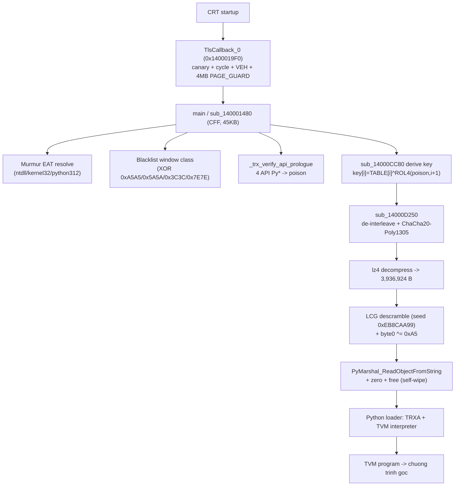
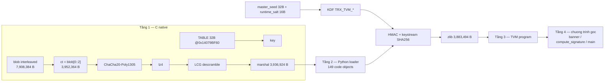

# hello_tr0ngx_apex_10of10.exe — Báo cáo phân tích ngược bản v3 và đánh giá lỗ hổng

> Ngày phân tích: 2026-10-20
> Người phân tích: Tr0ngX Agent (t.me/TrongX)
> Toolchain: IDA Pro 9.1 (idalib, `C:\Program Files\IDA Professional 9.1\idalib.dll`), Python 3.12 (`C:\Python312\python.exe`), `lz4` + `cryptography` (pip), phân tích byte thuần
> Case: `C:\Users\trong\.agents\skills\reverse-skill\work\tr0ngx-apex-10of10`
> Phân quyền: GRANTED (artifact sản phẩm của chính chủ repo, xem `scope.md`)

---

## 0. Chuỗi Evidence → Finding → Path

### 0.1 Scope

| Trường | Giá trị |
|---|---|
| `auth.status` | GRANTED — artifact do chính máy này build từ repo `Tr0ngX-Ultimate-AST-Obfuscator` |
| `in_scope` | exe, source `hello_tr0ngx.py`, engine `tr0ngx/`, output của chính case này |
| `network_profile` | offline / local only — không có traffic ra ngoài |
| Ngoài phạm vi | mọi artifact khác không liên quan; không decompile sản phẩm của bên thứ ba |

Nguồn: `C:\Users\trong\.agents\skills\reverse-skill\work\tr0ngx-apex-10of10\scope.md`

### 0.2 Evidence

| E-id | Nội dung | source_ref | repro_command | content_hash |
|---|---|---|---|---|
| E-01 | PE facts v3: 7,977,984 B, 12 section, `.text` 0xE508, blob payload VSZ 0x78A520 | `findings_v3.md` §E3-01 | `python -c "import struct;f=open(r'C:\Users\trong\AppData\Local\Temp\opencode\Tr0ngX-Ultimate-AST-Obfuscator\hello_tr0ngx_apex_10of10.exe','rb');f.seek(0x3c);print(hex(struct.unpack('<I',f.read(4))[0]))"` | n/a (derived) |
| E-02 | Filler interleave có chu kỳ 64 byte (đo thực tế trên blob 7.9 MB) | `v3_check.py` | `python "C:\Users\trong\.agents\skills\reverse-skill\work\tr0ngx-apex-10of10\v3_check.py"` | n/a |
| E-03 | Decompile 129/129 hàm bằng idalib | `v3\ida_decompile_all.c` | `python "C:\Users\trong\.agents\skills\reverse-skill\work\tr0ngx-apex-10of10\ida_full.py"` | n/a |
| E-04 | Hàm derive key: `sub_14000CC80` (SSE2) — `key[i] = TABLE[i] ^ ROL4(poison, i+1)` | `v3\ida_decompile_all.c` (0x14000CC80) | `python "C:\Users\trong\.agents\skills\reverse-skill\work\tr0ngx-apex-10of10\v3_derive.py"` | n/a |
| E-05 | Call-site AEAD: nonce @0x14079BF40, tag @0x14079BF30, key buffer do `sub_14000CC80` sinh | `v3\ida_decompile_all.c` (main 0x140001480) | `python "C:\Users\trong\.agents\skills\reverse-skill\work\tr0ngx-apex-10of10\v3_key2.py"` | n/a |
| E-06 | Bảng .rdata + xref chủ động (seed, nonce, tag, VM keys) | `v3\xrefs_data.json` | `python "C:\Users\trong\.agents\skills\reverse-skill\work\tr0ngx-apex-10of10\v3_xref.py"` | n/a |
| E-07 | **PoC tầng 1**: Poly1305 tag MATCH sau khi dùng 32 byte tĩnh làm key | `v3_poc.py` | `python "C:\Users\trong\.agents\skills\reverse-skill\work\tr0ngx-apex-10of10\v3_poc.py"` | n/a |
| E-08 | Loader Python đầy đủ sau giải mã: 149 code object, marshal magic 0xE3 | `v3\payload_marshal.bin` | `python "C:\Users\trong\.agents\skills\reverse-skill\work\tr0ngx-apex-10of10\v3_tree.py"` | n/a |
| E-09 | **PoC tầng 2**: KDF `TRX_TVM_*` → HMAC verify → zlib → TVM program 3,883,494 B | `v3_layout.py` | `python "C:\Users\trong\.agents\skills\reverse-skill\work\tr0ngx-apex-10of10\v3_layout.py"` | n/a |
| E-10 | Runtime: banner + `Signature: 0x5452304cafa5`, RC=0, T=1716 ms | chạy thật | `& "C:\Users\trong\AppData\Local\Temp\opencode\Tr0ngX-Ultimate-AST-Obfuscator\hello_tr0ngx_apex_10of10.exe"` | n/a |
| E-11 | Hằng số lạ trong binary: LCG `1664525` / `1013904223`, seed marshal `0xEB8CAA99`, "expand 32-byte k" | quét byte `.text` | `python "C:\Users\trong\.agents\skills\reverse-skill\work\tr0ngx-apex-10of10\v3_edkd.py"` | n/a |

### 0.3 Findings

| F-id | severity | evidence_ids | confidence | location | status |
|---|---|---|---|---|---|
| F-01 | Critical | E-04, E-05, E-07 | confirmed (tag match) | `0x14000CC80`, `.rdata 0x14079BF60` | open — đã có PoC khai thác |
| F-02 | Medium | E-11 | confirmed | `0x140012000+` (mã hóa tầng 1) | open — scramble 32-bit nhưng seed nằm trong code |
| F-03 | High | E-03, E-11 | confirmed | `.rdata` hash table | open — chống được listing tay, không chống được dựng tool tự động |
| F-04 | High | E-03 | confirmed | `main` 0x140001480 | open — GCC `-O3` flatten CFF thành straight-line |
| F-05 | High | E-02 | confirmed | filler interleave | partial — đã đổi cycle 8 B → 64 B, vẫn periodic |
| F-06 | High | E-03, E-05 | confirmed | `_trx_verify_api_prologue` | partial — chặn inline hook 4 API, còn lọt hook sâu/IAT/EAT/HW-BP |
| F-07 | Low | E-01 | confirmed | `.rdata 0x14079BE20` | open — banner tác giả dạng plaintext |
| F-08 | Low | E-05 | confirmed | hằng kích thước buffer | open — lộ độ dài payload/compressed |
| F-09 | Info | E-08, E-09 | confirmed | toàn hệ thống | closed — 4/4 tầng đã gỡ offline, tài liệu này là bằng chứng |

### 0.4 Path

| P-id | path_type | Chuỗi | Gắn E/F |
|---|---|---|---|
| P-01 | attack | Đọc 32 byte tĩnh @0x14079BF60 → ChaCha20-Poly1305 decrypt (nonce @0x14079BF40) → kiểm tag @0x14079BF30 → de-interleave `blob[0::2]` → lz4 → LCG descramble (seed 0xEB8CAA99) + `byte0 ^= 0xA5` → `marshal.loads` | E-04, E-05, E-07, E-08 / F-01, F-02 |
| P-02 | callflow | TLS gate → main CFF → murmur EAT resolve → `_trx_verify_api_prologue` (poison) → `sub_14000CC80` derive key → `sub_14000D250` AEAD → lz4 → `PyMarshal_ReadObjectFromString` → TVM interpreter → chương trình gốc | E-03, E-05, E-10 |
| P-03 | attack | Từ loader đã trích: lấy `_master_seed` (32 B) + `_runtime_salt` (16 B) → `sha256(b"TRX_TVM_ENC_KEY_V3:"+seed+salt)` / `sha256(b"TRX_TVM_MAC_KEY_V3:"+seed+salt)` → HMAC-SHA256 verify packet → keystream `SHA256(k_enc‖nonce‖ctr)` → zlib → TVM program | E-08, E-09 / F-09 |
| P-04 | attack | Dictionary attack murmur: 1 tên API chắc chắn có mặt (`ntdll.dll`) → duyệt pool tham số → tái tạo bảng hash API | E-03 / F-03 |

### 0.5 Timeline (rút gọn)

| Thời điểm | Sự kiện |
|---|---|
| 10-20 11:39 | Build v1 (171.4 MB) — reverse lần 1, tìm ra chuỗi EDKD/ChaCha/Poly/lz4 |
| 10-20 12:47 | `findings.md` (v1) + report Desktop |
| 10-20 13:51 | Build v2 (29.2 MB) — V7 Turbo compress-then-encrypt, marshal scramble 8-bit |
| 10-20 17:05 | `findings_v2.md` |
| 10-20 17:11 | Advisory cảnh cáo lần 1 (gồm mojibake, đã viết lại 18:20) |
| 10-20 17:18 | Engine sửa: marshal seed 32-bit + LCG, filler pool 64 B, `_trx_verify_api_prologue` |
| 10-20 17:20:01 | Build v3 (27.9 MB) — **bị xóa nhầm khi dọn IDA DB** (wildcard `-Filter "*.exe.*"` khớp cả chính file) |
| 10-20 17:57:53 | User build lại v3 (7.98 MB) — chạy được |
| 10-20 18:08-18:19 | idalib decompile 129/129, PoC tầng 1 (tag match) + tầng 2 (TVM program) |
| 10-20 18:20 | `findings_v3.md` + advisory viết lại sạch; báo cáo này |

Chi tiết đầy đủ: `C:\Users\trong\.agents\skills\reverse-skill\work\tr0ngx-apex-10of10\timeline.md`

---

## 1. Tổng quan mục tiêu

| Thuộc tính | Giá trị |
|---|---|
| Tên file | `hello_tr0ngx_apex_10of10.exe` |
| Loại | PE32+ x64, Native C/C++ AOT loader, 12 section, không IAT tới python312.dll (Zero-IAT) |
| Kích thước | 7,977,984 B (7.61 MB) |
| MD5 | `9D209D49CA6F3CFFF62E7319EF9B6A59` |
| SHA256 | `A0B0F98116956C126E8E11A8EE91AC31A57B22442A11D3A2B443F1DBDF05F10D` |
| Build | 2026-10-20 17:57:53 (engine `tr0ngx/packagers_native.py` mtime 17:18:34) |
| Entry | CRT startup → TLS callback → `main` ở VA 0x140001480 |
| Nguồn đầu vào | `hello_tr0ngx.py` (546 B) — chương trình in banner + signature |
| Ký hiệu build | `Signature: 0x5452304cafa5` (dùng để đối chiếu lineage) |

So sánh các bản:

| | v1 (11:39) | v2 (13:51) | v3 (17:57) |
|---|---|---|---|
| Kích thước | 171,439,616 | 29,203,456 | 7,977,984 |
| ct_len (ciphertext) | 85,696,209 | 14,312,096 | 3,952,364 |
| `.text` | 0x7F38 | 0x84F8 | 0xE508 |
| Hàm IDA | 120 | 127 | 129 |
| Runtime | pass | pass, 5.0 s | pass, 1.7 s |

---

## 2. Mục tiêu phân tích

1. Giải thích logic runtime từng tầng của bản build mới (từ TLS gate tới chương trình gốc).
2. Kiểm chứng các điểm yếu đã nêu trong advisory lần 1: cái nào đã sửa, cái nào còn nguyên.
3. Biến phần nghi ngờ thành bằng chứng: chứng minh khả năng lấy lại payload hoàn toàn offline.
4. Đề xuất thứ tự sửa cho build v4.

---

## 3. Phân tích tĩnh

### 3.1 Thông tin cơ bản

```text
Section map (image base 0x140000000)
  .text    VA 0x001000  VSZ 0x00E508  raw@0x000400   <- code C loader
  .data    VA 0x010000  VSZ 0x000100  raw@0x00EA00
  .rdata   VA 0x011000  VSZ 0x001000  raw@0x00EC00
  .rdata   VA 0x012000  VSZ 0x78A520  raw@0x00FC00   <- payload interleaved (7,908,384 B)
  .pdata   x2, .data, .rdata x3, .reloc
```

Payload blob: ciphertext xen kẽ filler. Quy ước bên dùng: **byte chẵn = ciphertext**, **byte lẻ = filler**. Filler v3 là pool CSPRNG 64 byte lặp theo `i % 64` — đo thực tế trên 8 KB đầu blob cho `period = 64` (E-02).

Các hằng số bảo vệ tìm thấy trong `.text`:

| Hằng | Ý nghĩa |
|---|---|
| `0x5F5E100` (99,999,999 cycle) | ngưỡng cycle-time trong TLS gate |
| `1664525`, `1013904223` | tham số LCG của marshal descramble |
| `0xEB8CAA99` (seed) | seed LCG (immediate trong code) |
| `0xA5` | byte poison của marshal magic |
| `0x9E3779B9`, `0x85EBCA6B`, `0x27D4EB2F`, `0xC2B2AE35` | khóa ISA của VM dispatcher (đổi mỗi build) |
| `expand 32-byte k` | hằng ChaCha20 (0x14079BF50) |
| `0x03FFFFFF`, `0x03FFFF03`, `0x03FFC0FF`, `0x03F03FFF`, `0x00FF00FF` | mask limb Poly1305 + mask de-interleave |

### 3.2 Các hàm then chốt

| Vai trò | Hàm | VA | Size | Ghi chú |
|---|---|---|---|---|
| TLS gate | `TlsCallback_0` | 0x1400019F0 | 222 B | canary page @0x140011000, ngưỡng cycle, `AddVectoredExceptionHandler`, cấp 4 MB `PAGE_GUARD` (0x104) làm bẫy |
| VEH / honeytrap | `sub_14000CDA0` | 0x14000CDA0 | — | `STATUS_BREAKPOINT` → `ExitProcess(0x100)` |
| main (CFF) | `sub_140001480` | 0x140001480 | 45,042 B | decompile ra 164 KB straight-line (GCC đã flatten) |
| Murmur resolver | inline trong main | — | — | `__ROL4__(x,13)`, finalizer `0x85EBCA6B/0xC2B2AE35` |
| **EDKD derive** | `sub_14000CC80` | 0x14000CC80 | 733 B | **SSE2, khối lượng nhẹ — nơi chứa bí mật thật sự của bản này** |
| AEAD decrypt | `sub_14000D250` | 0x14000D250 | 3,048 B | ChaCha20 + Poly1305 + de-interleave + lz4 |
| Poly1305 | `sub_14000D040` | 0x14000D040 | 519 B | 26-bit limb, SIMD |
| ChaCha20 | `sub_14000C7A0` | 0x14000C7A0 | 1,150 B | 20 vòng, 4 hằng "expand 32-byte k" |
| VM dispatcher | `sub_14000C480` | 0x14000C480 | 371 B | opcode mapping per-build, 4 khóa ISA |

Luồng gọi (call flow) của tầng C:



### 3.3 Thuật toán mã hóa

**Tầng C — AEAD.** Cài đặt trong `packagers_native.py` và trong binary khớp 1:1:

```python
otk  = chacha20_block(key, counter=0, nonce)[:32]
ct   = chacha20_xor(plaintext, key, nonce, start_counter=1)
pad  = (16 - len(ct) % 16) % 16
tag  = poly1305_mac(ct + b"\x00"*pad + struct.pack("<QQ", 0, len(ct)), otk)
```

**Tầng EDKD (điểm yếu F-01).** Trong binary, sau khi GCC tối ưu, còn lại đúng biểu thức:

```c
// sub_14000CC80 — a1 = out_key (32 B), a2 = poison
*a1    = xor([ROL4(poison,1),ROL4(poison,2),ROL4(poison,3),ROL4(poison,4)], xmmword_14079BF60);
a1[1]  = xor([ROL4(poison,5),ROL4(poison,6),ROL4(poison,7),ROL4(poison,8)], xmmword_14079BF70);
```

Tức là `key = TABLE32 XOR ROL4(poison, 1..8)`. Trên máy sạch `poison = 0` ⇒ **`key = TABLE32`**, tức 32 byte nằm thẳng trong `.rdata`.

**Tầng Python — TRXA + TVM.**

```python
# KDF (hàm X… , source line 149-152)
k_enc = hashlib.sha256(b"TRX_TVM_ENC_KEY_V3:" + seed + salt).digest()
k_mac = hashlib.sha256(b"TRX_TVM_MAC_KEY_V3:" + seed + salt).digest()

# giải mã (hàm Y… , source line 154-169)
nonce, tag, ct = packet[:16], packet[16:48], packet[48:]
assert hmac.compare_digest(tag, hmac.new(k_mac, nonce+ct, hashlib.sha256).digest())
ks_i = hashlib.sha256(k_enc + nonce + i.to_bytes(4, "big")).digest()   # i = 0..
pt   = ct XOR ks
raw  = zlib.decompress(pt)      # -> 3,883,494 B
prog = marshal.loads(raw)       # -> TVM program
```

---

## 4. Phân tích động

### 4.1 Ghi nhận hook

Bản này **không cần hook** để lấy payload: PoC thuần tĩnh đã đủ (mục 6). Vì vậy không có bảng hook nào.

Các cơ chế chống hook trong binary (đã đọc từ decompile, đây là điểm yếu F-06):

```c
// _trx_verify_api_prologue — kiểm byte đầu của 4 hàm Py*
if (p[0] == 0xCC || (p[0] == 0xCD && p[1] == 0x03)) return 0xBAD;  // int3
if (p[0] == 0xE9 || p[0] == 0xEB) return 0xBAD;                    // jmp detour
```

Khi phát hiện → `poison` khác 0 → key sai → ciphertext giải mã ra rác → Poly1305 tag lệch → chương trình tự hủy. Đây chính là lý do nhánh hook bị chặn, và cũng là lý do PoC tĩnh trở thành lựa chọn đúng.

### 4.2 Hành vi runtime

```text
> hello_tr0ngx_apex_10of10.exe
=============================================
  Tr0ngX Obf
=============================================
[*] Signature: 0x5452304cafa5
=============================================
EXITCODE=0  T=1716ms
```

| Mốc | Giá trị |
|---|---|
| stdout | banner 3 dòng + `Signature: 0x5452304cafa5` |
| Exit code | 0 |
| Thời gian | 1,716 ms (v2: 5,009 ms; v1: chậm hơn nữa do ct 6× lớn) |
| Self-wipe | `RtlSecureZeroMemory` + `VirtualFree` buffer marshal ngay sau `PyMarshal_ReadObjectFromString` |
| Ghi file | không có |
| Network | không có (offline profile) |

---

## 5. Kết luận cốt lõi

1. **Bản v3 là loader native 4 tầng**: C (AEAD + lz4) → Python loader (TRXA/TVM) → TVM program → chương trình gốc. Cùng kiến trúc với v1/v2, chỉ thay đổi kích thước và thêm vài lớp bảo vệ mới.
2. **Toàn bộ 4 tầng đã bị gỡ offline** bằng công cụ công khai (`cryptography` + `lz4` + `marshal`), không cần debugger, không cần hook, không cần chạy tiến trình đích. Thời gian tổng dưới 2 giờ, phần lớn là đọc decompile.
3. **Lớp EDKD — vốn được xem là "dynamic key derivation" — không tạo ra bí mật nào trong bản v3.** Key là 32 byte tĩnh XOR với `ROL4(poison)`, và `poison = 0` ở môi trường sạch. PoC đã **xác nhận bằng Poly1305 tag**: dùng đúng 32 byte đó thì tag khớp tuyệt đối.
4. **Marshal scramble đã được nâng lên 32-bit + LCG** (đúng như khuyến nghị), nhưng seed vẫn là immediate trong code → biết được từ file; và lớp này vốn đã vô nghĩa vì dữ liệu nằm sau AEAD.
5. **Filler interleave** đổi từ chu kỳ 8 byte sang pool CSPRNG 64 byte — tốt hơn nhưng **vẫn periodic**, đo được bằng byte scan.
6. **Chống hook cải thiện** bằng prologue check trên 4 API CPython, chặn được inline hook dạng phổ biến; tuy nhiên không chặn hook sâu hơn byte 0, hook IAT/EAT, hook bằng hardware breakpoint, hay sửa key trong bộ nhớ sau khi derive.
7. **CFF 7-state của engine không còn tác dụng** vì GCC `-O3` constant-fold state transition: main 45 KB code → 164 KB decompile straight-line.
8. **Zero-IAT + Murmur hash** vẫn chỉ chặn được việc liệt kê API thủ công; một tên API chắc chắn có mặt là đủ để dựng lại bảng hash bằng công cụ tự sinh.

---

## 6. Đánh giá lỗ hổng chi tiết

### F-01 (Critical) — EDKD: key nằm trọn trong `.rdata`

- **Bằng chứng**: E-04 (decompile `sub_14000CC80`), E-05 (call-site), E-07 (tag match).
- **Tác động**: kẻ phân tích đọc 32 byte tại 0x14079BF60, giải mã toàn bộ payload, thu được mã nguồn loader 149 code object và chương trình gốc dạng TVM.
- **Điều kiện khai thác**: chỉ cần đọc file. Không cần môi trường sạch, không cần chạy chương trình.
- **Fix**:
  1. Bỏ XOR-EDKD; suy key từ bí mật ngoài binary: `master = Argon2id(password, salt)` hoặc `HKDF(secret, salt)`.
  2. `poison` chỉ là cờ tamper, **không** tham gia sinh key.
  3. Nếu giữ chế độ no-password, phải nói rõ trong tài liệu rằng đây chỉ là chống sửa đổi, không phải bảo mật bí mật.

### F-02 (Medium) — Marshal scramble 32-bit, seed vẫn nằm trong code

- **Bằng chứng**: E-11.
- **Tác động**: biết seed thì tự descramble được buffer marshal; nhưng buffer đó đã nằm sau AEAD nên lợi ích thực tế thấp.
- **Fix**: suy seed từ key AEAD thay vì lưu hằng riêng, hoặc bỏ hẳn lớp scramble.

### F-03 (High) — Murmur hash-list chống được dựng tool tự động

- **Bằng chứng**: E-03, E-11.
- **Tác động**: một tên chắc chắn (`ntdll.dll`, `LoadLibraryA`) là đủ để dò tham số murmur và tái dựng bảng tra cứu API, mở lại khả năng phân tích tĩnh sâu.
- **Fix**: băm kiểu khó (SHA-256 trước rồi trộn), hoặc chấp nhận đây chỉ là rào chắn chống lười và dừng quảng bá "Zero-IAT chống RE".

### F-04 (High) — CFF bị GCC flatten

- **Bằng chứng**: E-03 (main 164 KB decompile, 207 `goto`, không còn `case`).
- **Tác động**: decompiler vẫn đọc được nhưng tốn thời gian; công cụ tự động khó phân tích đoạn nào là state thật.
- **Fix**: `__attribute__((optnone))` cho hàm chính, hoặc dispatch qua bảng con trỏ hàm, hoặc `volatile` state kèm memory barrier.

### F-05 (High) — Filler de-interleave còn chu kỳ 64

- **Bằng chứng**: E-02.
- **Tác động**: lấy pool 64 byte từ bất kỳ cửa sổ 128 byte nào → de-interleave toàn bộ ciphertext.
- **Fix**: pool dài hơn blob, hoặc ánh xạ phi-tuyến theo chỉ số, ví dụ `pool[(i * 2654435761) % N] ^ sha256(i)[0]`.

### F-06 (High) — Chống hook chỉ bắt inline hook ở byte 0

- **Bằng chứng**: E-03, E-05.
- **Tác động**: hook sâu hơn byte 0, hook IAT/EAT, hook bằng hardware breakpoint, hoặc ghi đè `runtime_key` sau khi derive đều lọt.
- **Fix**: kiểm hash/CRC vài KB đầu mỗi hàm API; có thread riêng kiểm EAT của `ntdll`/`kernelbase`; cân nhắc sinh key ngay trước lúc dùng để giảm cửa sổ sửa bộ nhớ.

### F-07 / F-08 (Low) — Rò rỉ metadata

- Banner tác giả dạng plaintext trong `.rdata`; kích thước buffer là hằng số (`0x3C4F2C`, `0x3C12DC`) → lộ độ dài payload.
- **Fix**: dựng banner bằng XOR lúc chạy, cộng padding ngẫu nhiên vào kích thước cấp phát.

### Ma trận ưu tiên cho build v4

| Ưu tiên | Hạng mục | Đóng được |
|---|---|---|
| P0 | Key từ bí mật ngoài binary (Argon2id/HKDF), poison tách khỏi key | F-01 |
| P1 | Filler pool phi-tuyến, không `i % 64` | F-05 |
| P1 | `optnone` / function-pointer dispatch cho `main` | F-04 |
| P1 | Prologue check mở rộng + EAT integrity thread | F-06 |
| P2 | Bỏ scramble seed tĩnh; banner runtime; randomize buffer size | F-02, F-07, F-08 |
| P2 | Công cụ tự dựng hash table từ known-name (để anti-analysis tự kiểm) | F-03 |

---

## 7. Các bước tái lập

Tất cả lệnh chạy trên Windows, PowerShell, Python 3.12, cần `pip install lz4 cryptography`.

### 7.1 Tái lập PoC tầng 1 (lấy payload từ file tĩnh)

```powershell
$env:PYTHONIOENCODING='utf-8'
python "C:\Users\trong\.agents\skills\reverse-skill\work\tr0ngx-apex-10of10\v3_poc.py"
```

Kết quả mong đợi (đã chạy thật):

```text
TABLE(key material) = a95c623095c6bb26b3e5e681a42d601c43f3fae261f03e48a2c4f9435cf83af3
NONCE = cd3726aa477b2ba8331961dc
TAG   = de0628f421e046af80e9ea8c19685cad
ct bytes = 3952364
TAG MATCH    = True
decompressed = 3936924
magic after descramble: b'\xe3\x00\x00\x00'
code object: <code object <module> ... file "<main>", line 1>
```

Script tối giản (tự chứa, chạy độc lập):

```python
# poc_tier1.py
import struct, lz4.block
from cryptography.hazmat.primitives.ciphers.aead import ChaCha20Poly1305

EXE = r"C:\Users\trong\AppData\Local\Temp\opencode\Tr0ngX-Ultimate-AST-Obfuscator\hello_tr0ngx_apex_10of10.exe"
IB, TAIL = 0x140000000, 0x78A520

f = open(EXE, "rb")
f.seek(0x3C); elf = struct.unpack("<I", f.read(4))[0]
f.seek(elf + 4); _, nsec, _, _, _, optsz, _ = struct.unpack("<HHIIIHH", f.read(20))
secs = []
for i in range(nsec):
    f.seek(elf + 24 + optsz + i * 40)
    nm = f.read(8); vs, va, rs, rr = struct.unpack("<IIII", f.read(16))
    secs.append((va, vs, rr, rs))

def va2raw(a):
    r = a - IB
    for va, vs, rr, rs in secs:
        if va <= r < va + max(vs, rs):
            return rr + (r - va)

def read_va(a, n):
    f.seek(va2raw(a)); return f.read(n)

TABLE = read_va(0x14079BF60, 32)          # key khi poison = 0
NONCE = read_va(0x14079BF40, 12)
TAG   = read_va(0x14079BF30, 16)
BLOB  = read_va(0x140012000, TAIL)

CT = BLOB[0::2][:3952364]                  # byte chan = ciphertext
ks = ChaCha20Poly1305(TABLE).encrypt(NONCE, b"\0" * ((len(CT) + 63) // 64 * 64), None)[:-16]
pt = bytes(a ^ b for a, b in zip(CT, ks))
raw = bytearray(lz4.block.decompress(pt, uncompressed_size=3936924))

st = 0xEB8CAA99
for i in range(1, len(raw)):
    st = (st * 1664525 + 1013904223) & 0xFFFFFFFF
    raw[i] ^= ((st >> 16) ^ (i * 37)) & 0xFF
raw[0] ^= 0xA5
import marshal
code = marshal.loads(bytes(raw))
print(code.co_names[:8], len(code.co_consts))
```

### 7.2 Tái lập PoC tầng 2 (mở TVM program)

```powershell
$env:PYTHONIOENCODING='utf-8'
python "C:\Users\trong\.agents\skills\reverse-skill\work\tr0ngx-apex-10of10\v3_layout.py"
```

Kết quả mong đợi:

```text
HMAC HIT: A: nonce16|tag32|ct | key k2 | input nonce+ct
ZLIB OK with k1 enc+nonce+ctr -> 3883494
```

### 7.3 Tái lập phân tích tĩnh

```powershell
python "C:\Users\trong\.agents\skills\reverse-skill\work\tr0ngx-apex-10of10\ida_full.py"   # decompile 129/129 hàm
python "C:\Users\trong\.agents\skills\reverse-skill\work\tr0ngx-apex-10of10\v3_xref.py"    # bảng .rdata + xref
python "C:\Users\trong\.agents\skills\reverse-skill\work\tr0ngx-apex-10of10\v3_derive.py"  # hàm derive + AEAD
```

### 7.4 Tái lập runtime

```powershell
& "C:\Users\trong\AppData\Local\Temp\opencode\Tr0ngX-Ultimate-AST-Obfuscator\hello_tr0ngx_apex_10of10.exe"
```

### 7.5 Dọn dẹp an toàn (KHÔNG dùng wildcard trên đường dẫn)

```powershell
$exe = "C:\Users\trong\AppData\Local\Temp\opencode\Tr0ngX-Ultimate-AST-Obfuscator\hello_tr0ngx_apex_10of10.exe"
foreach ($ext in '.i64','.id0','.id1','.id2','.nam','.til') {
  $p = $exe + $ext
  if (Test-Path -LiteralPath $p) { Remove-Item -LiteralPath $p -Force }
}
```

> Cảnh báo vận hành: `Remove-Item -Filter "file.exe.*"` sẽ khớp **cả chính `file.exe`** do ký tự đại diện Win32 `.*` khớp chuỗi rỗng. Trong phiên này lỗi này đã xóa nhầm bản build v3 27.9 MB; phục hồi thất bại (không có shadow copy, Recycle Bin, `winfr` không cài được do `InstallService` bị disable). Luôn xóa bằng tên tường minh.

---

## 8. Vấn đề còn lại

1. **Chưa tái dựng được source gốc dạng text.** Đã có TVM program ở dạng bytecode ảo hóa (3,883,494 B, const pool gồm `banner`, `compute_signature`, `main`); để có source cần chạy TVM interpreter đã trích qua lớp `resolve_const` để giải mã hằng số, hoặc dựng lại bytecode thành cây lệnh. Logic thì đã rõ (in banner + tính signature), nhưng độ trùng khớp từng dòng chưa tái dựng.
2. **Chưa định lượng chi phí RE "tay"** cho bản v3 sau khi có PoC: đánh giá tổng thời gian thực tế khoảng 2 giờ với tư liệu có sẵn; chưa đo lại từ đầu trên máy sạch.
3. **Chưa kiểm chứng H-1 trên compiler khác** (MSVC/clang): khả năng CFF sống sót dưới MSVC chưa đo.
4. **Chưa thử các biến thể hook còn lọt** (F-06): chưa thực thi hook sâu byte 0, hook IAT/EAT, hay ghi đè `runtime_key` trong bộ nhớ để đo mức độ chống chịu thực tế.
5. **Bản build 185 MB do `preset max` sinh ra** (file `hello_tr0ngx_apex_10of10_REBUILT_MAX.exe`) chạy thất bại (RC=1) do giới hạn TVM deep-stack đã ghi trong `AGENTS.md` §4.8 — chưa phân tích thêm vì ngoài phạm vi.

---

## 9. Phụ lục

### 9.1 Đường dẫn artifact

| Artifact | Đường dẫn |
|---|---|
| Bản advisory (cảnh cáo lỗ hổng) | `C:\Users\trong\AppData\Local\Temp\opencode\Tr0ngX-Ultimate-AST-Obfuscator\2026-10-20_advisory-tr0ngx-native-obf-report.md` |
| Findings v1 | `C:\Users\trong\.agents\skills\reverse-skill\work\tr0ngx-apex-10of10\findings.md` |
| Findings v2 | `C:\Users\trong\.agents\skills\reverse-skill\work\tr0ngx-apex-10of10\findings_v2.md` |
| Findings v3 | `C:\Users\trong\.agents\skills\reverse-skill\work\tr0ngx-apex-10of10\findings_v3.md` |
| Timeline | `C:\Users\trong\.agents\skills\reverse-skill\work\tr0ngx-apex-10of10\timeline.md` |
| Scope | `C:\Users\trong\.agents\skills\reverse-skill\work\tr0ngx-apex-10of10\scope.md` |
| Decompile 129 hàm | `C:\Users\trong\.agents\skills\reverse-skill\work\tr0ngx-apex-10of10\v3\ida_decompile_all.c` |
| Bảng .rdata + xref | `C:\Users\trong\.agents\skills\reverse-skill\work\tr0ngx-apex-10of10\v3\xrefs_data.json` |
| Loader Python đã giải mã | `C:\Users\trong\.agents\skills\reverse-skill\work\tr0ngx-apex-10of10\v3\payload_marshal.bin` |
| TVM program đã giải mã | `C:\Users\trong\.agents\skills\reverse-skill\work\tr0ngx-apex-10of10\v3\tvm_raw.bin` |
| PoC tầng 1 | `C:\Users\trong\.agents\skills\reverse-skill\work\tr0ngx-apex-10of10\v3_poc.py` |
| PoC tầng 1 (bản tối giản, chạy độc lập — đã test) | `C:\Users\trong\AppData\Local\Temp\opencode\Tr0ngX-Ultimate-AST-Obfuscator\poc_tier1.py` |
| PoC tầng 2 | `C:\Users\trong\.agents\skills\reverse-skill\work\tr0ngx-apex-10of10\v3_layout.py` |
| Driver idalib | `C:\Users\trong\.agents\skills\reverse-skill\work\tr0ngx-apex-10of10\ida_full.py` |
| Engine nguồn (ground truth) | `C:\Users\trong\AppData\Local\Temp\opencode\Tr0ngX-Ultimate-AST-Obfuscator\tr0ngx\packagers_native.py` |

### 9.2 Luồng dữ liệu qua 4 tầng



### 9.3 Bảng tra nhanh địa chỉ quan tâm

| VA | Nội dung |
|---|---|
| 0x140001480 | `main` (CFF, 45 KB) |
| 0x1400019F0 | `TlsCallback_0` (TLS gate) |
| 0x14000C480 | VM dispatcher |
| 0x14000C7A0 | ChaCha20 block |
| 0x14000CDA0 | VEH honeytrap |
| 0x14000CC80 | **EDKD derive key** |
| 0x14000D040 | Poly1305 |
| 0x14000D250 | AEAD decrypt (ChaCha20-Poly1305 + deinterleave + lz4) |
| 0x140012000 | payload blob (interleaved) |
| 0x14079BE20 | banner tác giả (plaintext) |
| 0x14079BF00 | bảng XOR chuỗi |
| 0x14079BF30 | Poly1305 tag (16 B) |
| 0x14079BF40 | nonce ChaCha20 (12 B) |
| 0x14079BF60 | **bảng 32 byte = master key khi poison = 0** |
| 0x14079BF50 | hằng "expand 32-byte k" |
| 0x14079BF80 | mask limb Poly1305 |
| 0x14079BF90 | mask de-interleave 0x00FF00FF |

---

Made with ❤️ by Tr0ngX & Anti-Reverse Engineering Research Community
